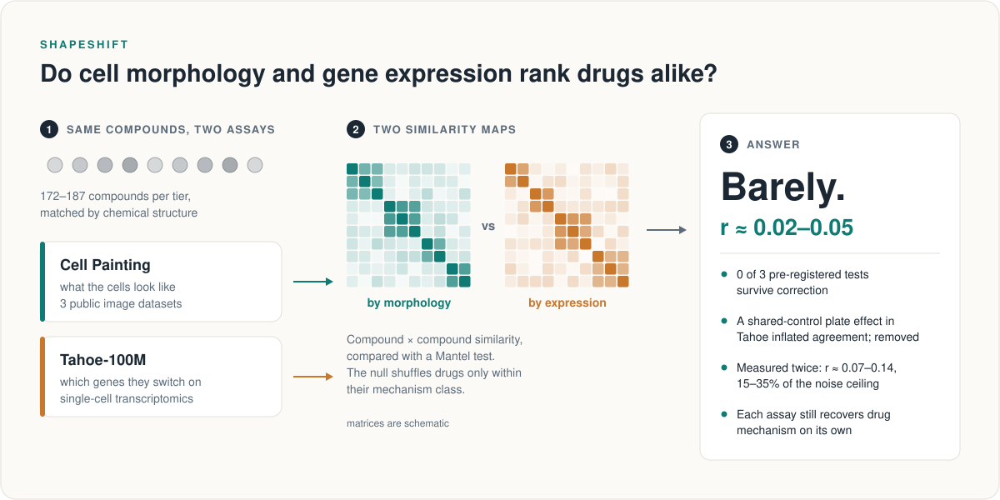
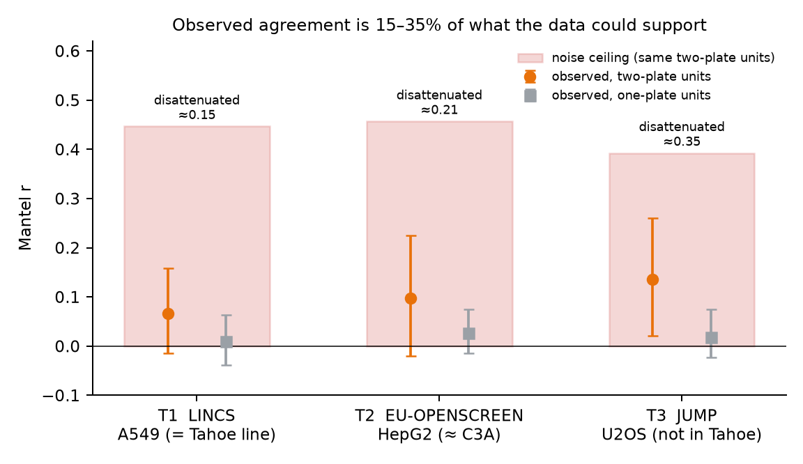

# ShapeShift

**Do Cell Painting morphology and Tahoe-100M transcriptomics encode the same compound similarity? Barely.**

[](../../actions/workflows/ci.yml)



## Finding

I built compound × compound similarity matrices from cell morphology (three Cell Painting datasets) and from single-cell transcriptomics (Tahoe-100M), over the same compounds, and asked whether they agree beyond shared mechanism-of-action (MoA) class.

- **None of the three pre-registered tests survives correction.** Mantel r = 0.054, 0.058 and 0.092, with within-MoA-null p = 0.25, 0.31 and 0.035; Bonferroni α = 0.0167.
- **A confound in Tahoe inflates apparent agreement.** Every drug on a Tahoe plate shares one DMSO control, so same-plate drugs look alike. After removing that plate effect, all three datasets show the same small agreement, **r ≈ 0.02–0.05**.
- **Agreement rises to r ≈ 0.07–0.14 where Tahoe measured the compound twice.** That is still only **~15–35% of the noise ceiling**. The limit is single-well transcriptomic noise, not cell-line mismatch.
- **Matching the cell line did not help.** A549 morphology vs Tahoe's A549 agrees no better than U2OS morphology vs Tahoe's cross-line consensus, even on the same compounds.
- **Each modality recovers MoA on its own** (mAP 0.26–0.37 for morphology, 0.17–0.19 for the transcriptome, against a null of 0.11). They don't rank compounds alike beyond class membership.



The full write-up is in **[REPORT.md](REPORT.md)**.

## Design

| Tier | Morphology | Cell line vs Tahoe | Exposure | Compounds |
|---|---|---|---|---|
| T1 | LINCS Cell Painting (cpg0004), 6 doses | A549 = A549 | 48 h vs 24 h | 187 |
| T2 | EU-OPENSCREEN bioactives (cpg0036 / Zenodo) | HepG2 vs HepG2/C3A | 24 h vs 24 h | 172 |
| T3 | JUMP-CP (cpg0016) | U2OS, not a Tahoe line | 48 h vs 24 h | 175 |
| Calibration | CPJUMP1 (cpg0000) | A549 and U2OS, same protocol | – | 306 |

- **T1 and T2 have opposite confounds.** T1 matches the cell line but not the exposure time; T2 matches the time but not the exact line. They are reported side by side, never pooled.
- **Compounds are matched by structure.** RDKit standardization with stereo-flat InChIKeys, plus a formula and heavy-atom-graph tier, because JUMP stores many drugs as unusual tautomers (sunitinib, dexamethasone, rapamycin …).
- **Profiles are normalized within each dataset only:** per-plate robust z-scores against controls, feature selection, then whitening.
- **Tahoe data are streamed, never downloaded whole.** Fold changes come from HTTP range reads of the official pseudobulk tables: 14.9 GB of a ~90 GB release.
- **Primary statistic:** Spearman Mantel test on annotated compounds, with a null that permutes **within MoA class**, plus unit-bootstrap CIs.

## Limitations

- **Two analyses are post hoc.** Plate centring and the two-plate analysis were added after the primary tests, in response to confounds found in the data. Both are labelled secondary.
- **Tahoe pools 50 cell lines per well**, and its DESeq replicate scheme is undocumented. Only fold changes are used.
- **Replicate wells share positions.** LINCS and EU-OPENSCREEN place replicates at fixed well positions, so morphology reliabilities are upper bounds.
- **Exposure (24 h vs 48 h) and dose (5 vs 3.33/10 µM) differ** across tiers. Only 3 of the 6 LINCS doses lie within 1.5× of a Tahoe dose.
- **MoA labels are sparse:** ~50% are "unclear". The noise ceiling rests on 45–61 two-plate compounds per tier.

## Reproduce

```bash
pip install -r requirements.txt     # Python 3.13, pinned
pytest -q tests                     # CPU unit tests (matching + statistics engine), seconds
python run_all.py                   # full pipeline from public sources: ~22.5 GB streamed, peak disk <= 7.5 GB, hours
python run_all.py --from compare    # statistics + figures only, from previously built tables (~25 min)
```

- **No data are committed.** Every step downloads what it needs from Hugging Face, the Cell Painting Gallery (S3), Zenodo, GitHub or PubChem, and raises an error if a source is unreachable.
- **Committed outputs:** summary statistics in `step2/results/` and figures in `figures/`.
- **Licenses:** dataset licenses and redistribution notes are in [DATA_LICENSES.md](DATA_LICENSES.md). The code is MIT.

## Layout

```
overlap.py              Step 1: Tahoe-100M x JUMP-CP structure matching
cellcheck/              which Tahoe lines exist in which Cell Painting sets
step2/                  pipelines (tahoe_signatures, jump_profiles, morph_lincs, morph_euos, morph_cpjump1),
                        statistics (compare_tiers.py), figures (make_figures.py), results/
docs/                   step reports, cell-line check, per-pipeline engineering notes
tests/                  CPU unit tests run in CI
```

## Data and citations

This repository contains no third-party data; see [DATA_LICENSES.md](DATA_LICENSES.md) and [NOTICE](NOTICE).

- **Tahoe-100M** (CC0): Zhang et al. 2025, doi:10.1101/2025.02.20.639398.
- **Cell Painting Gallery** (CC0): Weisbart et al. 2024, doi:10.1038/s41592-024-02399-z.
  - JUMP-CP: Chandrasekaran et al. 2023.
  - CPJUMP1: Chandrasekaran et al. 2024, doi:10.1038/s41592-024-02241-6.
  - LINCS Cell Painting: Way et al. 2022.
- **EU-OPENSCREEN** (CC BY 4.0): Wolff et al. 2025, doi:10.1016/j.isci.2025.112445; Zenodo doi:10.5281/zenodo.19347244.
- **Drug Repurposing Hub** (used at run time only, for non-commercial research): Corsello et al. 2017, doi:10.1038/nm.4306.
