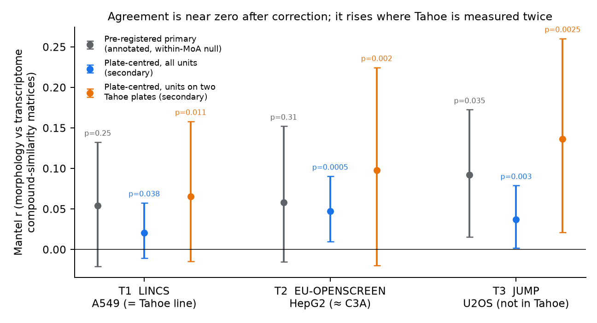
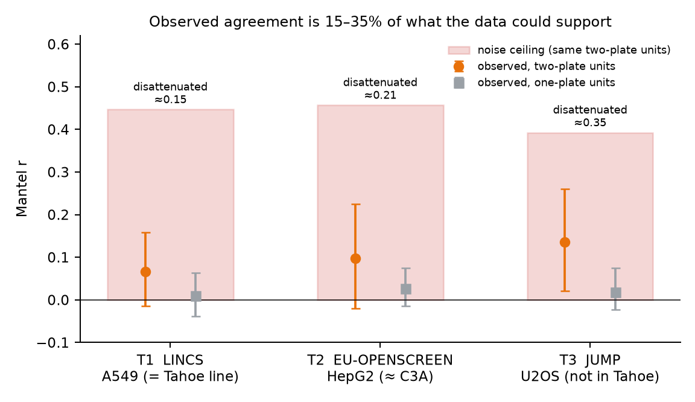
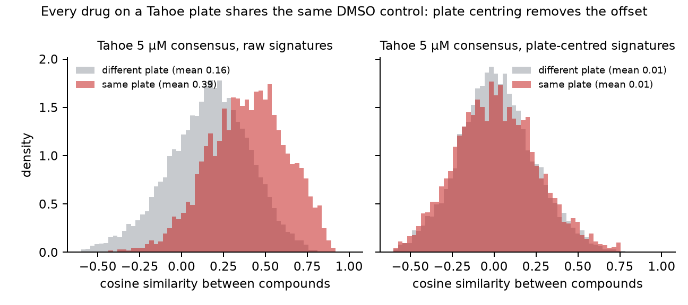
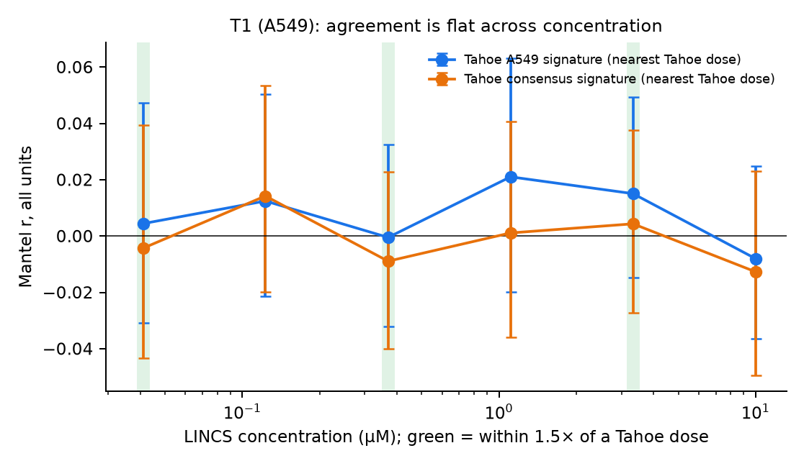

# ShapeShift: do Cell Painting morphology and Tahoe-100M transcriptomics encode the same compound similarity?

**Short answer: barely.** Across three Cell Painting datasets and Tahoe-100M single-cell RNA-seq, no pre-registered test of morphology–transcriptome agreement survives multiple-testing correction.

After a confound in Tahoe is removed (shared DMSO controls per plate), all three tiers show the same small agreement, Mantel r ≈ 0.02–0.05. On the compounds Tahoe measured in two independent wells, agreement rises to r ≈ 0.07–0.14. That is still only **~15–35% of the noise ceiling**.

Each modality recovers mechanism of action (MoA) on its own; they just don't rank compounds alike beyond class membership. Matching the cell line did not help. Replication of the transcriptomic measurement did.

This document is the full write-up. [README.md](README.md) is the summary. Supporting detail:
- [docs/STEP1_REPORT.md](docs/STEP1_REPORT.md): compound overlap
- [docs/CELL_LINE_CHECK.md](docs/CELL_LINE_CHECK.md): which Cell Painting sets use Tahoe's cell lines
- [docs/STEP2_REPORT.md](docs/STEP2_REPORT.md): the working analysis report, with every number
- [docs/notes/](docs/notes/): per-pipeline engineering notes

---

## 1. Question and why it matters

Two of the largest public perturbation resources describe what a compound does to cells in different ways:

| | Cell Painting (JUMP-CP and related) | Tahoe-100M |
|---|---|---|
| What is measured | Morphology: ~1–5k CellProfiler features of stained cells | Transcriptome: single-cell RNA-seq |
| Scale | ~116k compounds in JUMP | 379 drugs × 3 doses × 50 cancer lines |

If both modalities encode the same compound similarity structure, three things follow: one could stand in for the other; morphology could serve as a cheap proxy for transcriptional MoA; and cross-modal models (Part C) would be learning a shared signal. If they don't, the modalities are at best complementary.

The test: build a compound × compound similarity matrix in each modality, over the same compounds, and ask whether the two matrices agree (Mantel test), beyond what shared MoA class alone explains.

## 2. Step 1: compound matching

**Problem.** Tahoe lists drugs by name and SMILES; JUMP lists compounds by JCP2022 ID with InChIKey and SMILES. Matching on InChIKey alone loses many well-known drugs, for three reasons:

1. **JUMP is stereo-flat.** 99.999% of JUMP InChIKeys carry the no-stereo block `-UHFFFAOYSA-`, and Tahoe's SMILES are also mostly flat.
2. **Salts and solvates** (mesylate, hydrochloride, hydrates) change the key.
3. **JUMP draws many drugs as unusual tautomers or with shifted double bonds**, which changes even the first InChIKey block. Examples:
   - sunitinib as a hydroxy-indole;
   - dexamethasone and the other corticosteroids as Δ5 dienes;
   - piroxicam and meloxicam as keto-imines;
   - rapamycin, paclitaxel and docetaxel.

**Method** (`overlap.py`). Every structure is standardized with RDKit: cleanup, largest organic fragment, neutralize, remove stereo, then InChIKey. Matches are assigned in tiers:

| Tier | Rule | Tahoe drugs |
|---|---|---|
| 1a | Equal standardized InChIKey, drug achiral (no stereocentres per PubChem's isomeric SMILES), so truly exact | 160 |
| 1b | Equal standardized InChIKey, drug chiral, so the stereoisomer cannot be confirmed (JUMP is flat) | 155 |
| 2b | Same molecular formula and same heavy-atom graph (RDKit `ElementGraph` hash): the same molecule drawn as a different tautomer or bond pattern | 42 |
| 3 | Name or PubChem bridge, or metal stripped by standardization; flagged for review | 1 (auranofin; its JUMP match lacks the gold) |
| — | Unmatched | 21 |

**Validation.**
- JUMP's own control list names positive control `JCP2022_025848` "dexamethasone", and only tier 2b finds it.
- Requiring the same formula keeps real analogs apart. For example, belzutifan (2,3-difluoro) is *not* matched to its 2,2-difluoro analog.
- Both cases are unit tests in `tests/test_matching.py`.

**Result: 357 of 379 Tahoe drugs match (331 unique JUMP compounds), across 22 MoA classes with ≥3 compounds.** Approved oncology drugs missing from JUMP include bortezomib, oxaliplatin, adagrasib, pemigatinib and the RAS(ON) inhibitors.

**Doses.** JUMP compound plates are 10 µM in every source except source_7, which is 0.625 µM. The comparison set for JUMP is the compounds measured at both doses: **175 compounds** (186 Tahoe drug entries).

**Corrected bug.** An early version reported 177. A pandas `~` applied to an object column turned `True` into `-2`, which is truthy, so the "exclude positive controls" filter kept dexamethasone and quinidine. Fixed and documented.

## 3. Three-tier design

Tahoe screened 50 cancer lines. A549 is one of them. HepG2 is not; Tahoe used the HepG2/C3A subline (Cellosaurus CVCL_1098), a clonal derivative of HepG2. U2OS, the JUMP cell line, is not among them.

This turns cell line into a controlled variable. Three Cell Painting datasets were matched to Tahoe with the same chemistry logic:

| Tier | Morphology dataset | Cell line vs Tahoe | Exposure (morphology vs Tahoe) | Units | Primary pairing |
|---|---|---|---|---|---|
| **T1** | LINCS Cell Painting (cpg0004): 136 plates, 6 doses | **A549 = A549** | 48 h vs 24 h | 187 | 3.33 µM vs Tahoe 5 µM, A549 signature |
| **T2** | EU-OPENSCREEN bioactives (cpg0036): 4 sites | HepG2 vs HepG2/C3A | **24 h vs 24 h** | 172 | 10 µM vs 5 µM, HepG2/C3A signature |
| **T3** | JUMP-CP (cpg0016): 416 plates | U2OS, absent from Tahoe | 48 h vs 24 h | 175 | 10 µM vs 5 µM, cross-line consensus |
| Calibration | CPJUMP1 (cpg0000) | A549 **and** U2OS, same protocol | 24 h and 48 h | 306 compounds | – |

**T1 and T2 have orthogonal confounds.** T1 matches the cell line exactly but not the exposure time; T2 matches the time but uses a closely related line. If both agree, neither confound can explain the agreement, so they are reported side by side and never pooled.

**T3 has the largest N but the most mismatched biology.** CPJUMP1 images the same compounds in A549 and U2OS under one protocol, so it measures how much morphology changes with cell line alone.

**Units.** A unit is Tahoe's standardized parent structure, so salt forms collapse together.
- Excluded: auranofin, and estrone sulfate → estrone (a different molecule).
- Stereo/racemate pairs (e.g. levobupivacaine vs bupivacaine) are flagged, kept in the main analysis, and dropped in an exact-achiral sensitivity rerun.

## 4. Pipelines

**Transcriptome (Tahoe-100M).** The source is the official pseudobulk DESeq tables on Hugging Face: log2 fold change per cell line × drug × dose × plate, against the same plate's DMSO in the same line.

- **Access.** The tables are ~90 GB across 1,026 parquet files, sorted by cell line and not by drug. Parquet footers and the needed row groups were read by HTTP range requests: 14.9 GB streamed, no file downloaded whole. A small custom column decoder avoided reading footers twice and was verified against pyarrow with 0 mismatches.
- **Aggregation.** Signatures were aggregated at well level first, then averaged across wells. Conditions with fewer than 100 treated cells were dropped, which removed two lines entirely. 5,000 well-expressed genes were kept.
- **Gate.** T2 required enough HepG2/C3A cells: the median is 937 per drug at 5 µM, so it passed.

**Morphology (three datasets, plus CPJUMP1).** Each dataset was processed strictly on its own, because the CellProfiler pipeline versions differ and features must never be merged across datasets.

1. Well-level CellProfiler profiles were normalized per plate with a robust z-score against negative controls.
2. Features were selected: blocklist, outliers, low variance, then |r| > 0.9 pruning.
3. Profiles were PCA-whitened, fitted on the controls.
4. Replicate wells were combined by median; then the mean was taken across sites or sources.

The EU-OPENSCREEN profiles are not in the Cell Painting Gallery. They came from Zenodo, read by range requests into a 1.35 GB zip.

All accessions were resolved from the Cell Painting Gallery's own S3 index, not hardcoded.

## 5. Pre-registered tests and results

**Test.** Before any results were seen, one primary test per tier was fixed:
- Spearman Mantel r between cosine-similarity matrices, on MoA-annotated units.
- The null permutes compound labels **only within MoA class** (singletons fixed), 9,999 permutations. A naive permutation null only rediscovers that MoA classes exist.
- 95% CIs from a unit bootstrap.

**Result.**

| | T1 LINCS A549 | T2 EU-OS HepG2 | T3 JUMP U2OS |
|---|---|---|---|
| Primary r [95% CI] | 0.054 [−0.021, 0.133] | 0.058 [−0.015, 0.152] | 0.092 [0.016, 0.173] |
| Within-MoA null mean | 0.043 | 0.046 | 0.044 |
| p (one-sided) | 0.25 | 0.31 | 0.035 |

With Bonferroni over the three primaries (α = 0.0167), **none is significant**. In T1 and T2 the observed r roughly equals the within-MoA null mean, so whatever agreement exists is what shared class membership predicts.

The naive permutation null *would* have called all three significant (p = 0.015, 0.014, 0.004). This shows how much the choice of null matters.

## 6. A confound found in Tahoe: shared DMSO controls per plate (secondary analysis)

**How it was found.** In the Tahoe similarity matrix, compound pairs on the same Tahoe plate have mean cosine 0.39, against 0.16 for different plates (Fig. 3), and 26–29% of all pairs share a plate.

**Why.** Every drug on a plate has the *same* DMSO pseudobulk subtracted, so measurement noise in that one control enters every drug's signature. Tahoe also co-plates same-MoA drugs more often than chance (40% vs 30% of pairs), so the plate effect partly masquerades as MoA signal.

**How it was removed.** From each signature, subtract the mean signature of all ~80 drugs on the same plate × cell line × dose, averaged over the unit's plates. Afterwards, same-plate and different-plate pairs both have mean cosine 0.01.

**Status: secondary.** This was added after the primary test was declared, because the confound was discovered in the data. Both versions are reported throughout.

**Result after centring.** All three tiers show a small positive agreement, pointing the same way despite their opposite confounds:

| | T1 | T2 | T3 |
|---|---|---|---|
| All units, plate-centred | 0.020 [−0.011, 0.058], p = 0.04 | 0.048 [0.010, 0.091], p ≤ 0.0005 | 0.037 [0.002, 0.079], p = 0.003 |
| Annotated, within-MoA null, centred | 0.041, p = 0.02 | 0.058, p = 0.017 | 0.020, p = 0.14 |

## 7. Noise ceiling: what limits agreement is single-well replication

A Mantel r cannot exceed √(reliability of matrix 1 × reliability of matrix 2).

- **Morphology split-half reliability** (Spearman–Brown corrected) is high: 0.82 (T1, 3.33 µM), 0.95 (T2), 0.77 (T3). These are upper bounds because of well-position confounds (§10).
- **Tahoe reliability** can only be measured where a compound was profiled in two independent wells, on different plates with different controls. That covers 93 units at 5 µM; across the three tiers, 45–61 units are on two plates and the rest on one. Building the similarity matrix from plate copy 1 and from plate copy 2 gives a plate-centred reliability of 0.23–0.28. At 0.05 and 0.5 µM it is about 0.

On the same two-plate units:

| | T1 | T2 | T3 |
|---|---|---|---|
| Observed r, two-plate units (n) | 0.066 (61) [−0.015, 0.158] | 0.098 (56) [−0.020, 0.225] | 0.136 (45) [0.021, 0.260] |
| Observed r, one-plate units (n) | 0.009 (126) | 0.027 (115) | 0.019 (130) |
| Noise ceiling, same two-plate units | 0.45 | 0.46 | 0.39 |
| **Disattenuated agreement** (observed / ceiling) | **≈ 0.15** | **≈ 0.21** | **≈ 0.35** |

**Interpretation.**
- Two-plate units are *not* stronger drugs: their centred signature magnitude is lower (14–15 vs 20–22). Their consensus signatures simply average two independent wells.
- Agreement is several-fold higher where the transcriptome is measured twice. The limiting factor is the noise of single-well transcriptomic signatures, not the cell-line mismatch (§8).
- Even so, the disattenuated agreement is only about 0.15–0.35: much of the reliable structure in each modality is not shared.
- Caveat: which drugs Tahoe placed on two plates was not randomized, so the two-plate subset could differ in ways other than noise.

## 8. Matching the cell line did not help

If the U2OS-vs-Tahoe mismatch were what held T3 back, the cell-line-matched T1 should agree more. It does not:

| | T1 (A549 = A549) | T3 (U2OS vs consensus) |
|---|---|---|
| All units | 0.015 | 0.044 |
| Same 92 compounds (T1∩T3) | −0.008 | 0.041 |

- With plate-centred per-line signatures, A549 ranks 10th of 48 Tahoe lines for agreement with LINCS A549 morphology, and HepG2/C3A ranks 27th for EU-OPENSCREEN HepG2. Both are within ~0.005 of the median line, so there is no detectable matched-line advantage.
- **CPJUMP1 calibration.** The same 306 compounds imaged in A549 and U2OS keep 39–52% of their reliable similarity structure (48 h; disattenuated). Cell line does change morphology, but that is not what limits cross-modal agreement here.

## 9. Each modality recovers MoA on its own

Leave-one-compound-out nearest-neighbour MoA retrieval on annotated compounds, with queries from classes of ≥3 members:

| | Morphology mAP (top-1) | Transcriptome mAP (top-1) | Label-permutation null mAP |
|---|---|---|---|
| T1 | 0.34 (0.43) | 0.19 (0.21) | 0.12 |
| T2 | 0.37 (0.47) | 0.19 (0.22) | 0.12 |
| T3 | 0.26 (0.27) | 0.19 (0.17) | 0.11 |

All are p ≤ 0.002, and the transcriptome's retrieval survives plate-centring. Both spaces know MoA. They do not rank compounds alike *within and across* classes. Low agreement is not because either modality is uninformative.

## 10. Dose

**Only 3 of the 6 LINCS doses lie within 1.5× of a Tahoe dose:** 0.041→0.05, 0.37→0.5 and 3.33→5 µM. The other three are 2.2–2.4× away.

**Agreement is flat across concentration** (Fig. 4). The all-unit r is between −0.013 and +0.021 at every LINCS dose, and every CI includes 0. Tahoe signatures also carry no reliable structure below 5 µM: only 4–8% of conditions are "active", and median signature magnitude does not rise with dose.

**Does one modality respond at lower concentrations? The data cannot answer this.** With the activity calls as specified, morphology "responds first" for 134 compounds against 2. But those calls differ about 10× in sensitivity, and Tahoe's norm-based call tracks cell count (Spearman −0.70), i.e. cytotoxicity. Once the two calls are equally strict, only **11 compounds** are active in both modalities at any matched dose, split 12 morphology-first vs 11 transcriptome-first.

## 11. Data pitfalls (useful for anyone reusing these resources)

1. **Tahoe pools all 50 cell lines in one well per drug × dose.** Cells sharing a well are not independent, and cross-line "consistency" computed inside a well is inflated by well effects. After centring, the same drug in different lines of the same well correlates at r ≈ 0.31, against r ≈ 0.20 in a different well.
2. **Tahoe's DE replicate scheme is undocumented.** The public plugin mentions "pseudoreplicates". Only fold changes were used, never Tahoe p-values.
3. **Shared DMSO per plate** creates the plate effect in §6. Centre on plate × line × dose means before comparing drugs.
4. **Fixed well positions.** Every LINCS and EU-OPENSCREEN replicate pair, and about 47% (high dose) and 100% (low dose) of JUMP compound wells, share a well position with other replicates. Position effects are real: DMSO wells at the same position on different plates have cosine 0.03–0.07, against ≈0 at different positions. Replicate reproducibility, and any activity call against a DMSO null, is therefore inflated. The simple DMSO-null calls saturate (85–99% "active") in every dataset; position-matched nulls are needed.
5. **EU-OPENSCREEN sites disagree strongly.** Replicate cosine is 0.37 within a site and 0.15 across sites.
6. **The JUMP chemistry quirks of §2** (stereo-flat keys, unusual tautomers) would silently drop 42 of the 357 matched drugs (about 12%) from a naive InChIKey join.
7. **Tahoe's DE files are sorted by cell line, not by drug**, so drug-level pruning saves almost nothing. Each footer is about 5.8 MB, roughly 6 GB in total.

## 12. What this implies

- **Low agreement on similarity structure does not mean the modalities are useless together.** Both carry MoA information, and much of their reliable structure is *not* shared, which is exactly what complementary information looks like. Whether they are jointly informative about an outcome such as cell viability is a separate question, and the natural next test (Part C, design only).
- **For anyone hoping to use morphology as a cheap proxy for transcriptional similarity across a compound library,** the data argue against it at current measurement quality. If the prediction task is attempted, it should be restricted to compounds with replicated, high-dose transcriptomic measurements.
- **For Tahoe users:** plate-centre the signatures, use 5 µM, and treat single-well signatures as noisy.

## 13. Limitations

1. **Post hoc analyses.** Plate-centring and the two-plate split were added after the primary tests were declared. Both are labelled secondary.
2. **Multiple testing.** Of 262 secondary tests that carry a p-value, 77 are < 0.05, most of them naive-permutation tests, which succeed by design. 14 of 71 within-MoA tests are nominal hits against ~3.5 expected; they are correlated, so this is supportive, not independent, evidence.
3. **Exposure times differ:** 48 h for LINCS and JUMP, 24 h for Tahoe and EU-OPENSCREEN.
4. **Doses differ:** Tahoe 5 µM is paired with 3.33 or 10 µM morphology.
5. **MoA labels are sparse:** about 50% of Tahoe `moa-fine` labels are "unclear", so within-MoA tests use 82–85 annotated units per tier.
6. **Stereochemistry is collapsed:** enantiomers and epimers share one unit in every dataset (e.g. doxorubicin/epirubicin).
7. **The noise ceiling rests on few units:** 45–61 per tier, and their selection by Tahoe's plate design was not random.

## Figures

| | |
|---|---|
|  |  |
| **Fig. 1** Agreement per tier, with 95% bootstrap CIs: pre-registered primary, plate-centred, and two-plate units. | **Fig. 2** Observed agreement vs the noise ceiling on the same units. |
|  |  |
| **Fig. 3** Tahoe plate effect before and after centring. | **Fig. 4** T1 agreement vs LINCS concentration. |

## Reproduce

See [README.md](README.md#reproduce). `python run_all.py` reruns everything from public sources: about 22.5 GB streamed, peak disk ≤ 7.5 GB, several hours on a laptop. `pytest tests` runs the CPU unit tests in seconds. Data licenses are listed in [DATA_LICENSES.md](DATA_LICENSES.md).
